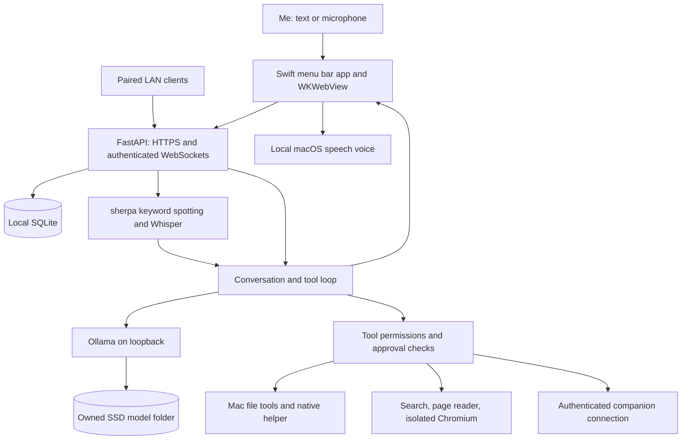

# How Jarvis is put together

This describes the code that exists today. I’ve kept the future design in [FUTURE_DEVELOPMENT.md](FUTURE_DEVELOPMENT.md) so it’s clear what still needs building.

## The main parts

The MacBook Air hosts inference, the database, and the tools. Remote clients send requests to this host. A companion connection is a separate mechanism for a small set of actions on another Mac; pairing a client does not automatically give it every host privilege.

## App and connection setup

`native/Jarvis.swift` builds a menu bar app using AppKit. Its window embeds `web/index.html`, `web/app.js`, and `web/style.css` through WKWebView. The native bridge handles microphone permission, local speech output, Keychain token storage, exports, service controls, and file-permission guidance.

The backend serves HTTPS on port 8765. Setup creates a private CA and a server leaf certificate with server-authentication usage and local hostname/IP SANs. The native client validates the name, chain, and installed certificate pins. Tokens are injected after asynchronous Keychain retrieval, avoiding a blocked window while a Keychain prompt is pending.

LAN mode binds loopback and detected private IPv4 addresses explicitly. It does not bind a public wildcard address. Certificate SANs are generated during setup; network changes may need certificate/enrolment maintenance rather than bypassing TLS verification.

## A text request

1. The client posts text and a conversation identifier to `/api/chat` with a device bearer token.
2. The backend checks the token against a stored hash, records the message, and retrieves recent history plus selected global memory.
3. `inference.py` chooses the configured conversation or tool model and exposes relevant tools within that device’s scope.
4. Ollama generates an answer or structured calls. Tool arguments are validated against strict schemas before execution.
5. Read-only calls can run within the allowed scope. Changes and sensitive actions create an approval with an expiry and a preview.
6. A tool result is returned as structured context. Grounding retries/fallbacks help prevent false claims about unread files or successful actions.
7. The answer and relevant events are saved, then displayed or spoken by the client.

The loop is bounded to six model turns and four calls per turn. It is not a durable task scheduler. The small models can still misinterpret requests; successful tool execution is evidence, not a guarantee that every answer is correct.

## Local models and storage

The deployed runtime is Ollama 0.40.14 at `127.0.0.1:11435`, with cloud mode off. The host uses `qwen3.5:2b` for ordinary conversation and `qwen3.5:4b` for file/browser requests. Only one model is loaded at a time, which suits a 16 GB unified-memory Mac but introduces model-switch latency. The deployed request context is 6,144 tokens; fresh defaults use 4,096 until configured.

`storage.py` owns the model-storage boundary. Initialization checks drive metadata, atomically allocates a new top-level folder, records the volume UUID, and writes a binding marker. Owned storage operations validate that identity and use directory descriptors with `O_NOFOLLOW`. Existing unrelated SSD data is outside this storage API.

`service.py` supervises the model process and checks storage availability every ten seconds. The model child runs under a sandbox profile allowing the owned SSD folder and denying other external-volume content. If the binding disappears or changes, it stops inference and retries after the drive returns. There is no internal emergency language model fallback today.

This model-storage boundary is separate from the full personal-file tools that I explicitly enabled.

## Voice

The client sends ephemeral 16 kHz float32 audio over an authenticated WebSocket. `voice.py` runs sherpa-onnx keyword spotting for the wake phrase, energy-based endpoint detection, and an int8 Whisper tiny.en transcriber. Recognised text goes through the same inference/tool path as typed text. The native app speaks the result with AVFoundation using an installed local voice.

The client pauses microphone transmission while it speaks. There is an eight-second follow-up window and a push-to-talk option. The UI can select an enumerated input microphone; output follows system sound settings. Automatic acoustic interruption, stronger echo handling, dedicated output routing, and multilingual transcription remain future work. Raw voice audio is not automatically saved to a recordings archive.

## File and application tools

`filesystem.py` supports full or restricted mode. Full mode resolves ordinary absolute and home-relative paths, respects macOS access controls, and reports inaccessible/partial search results. Search combines Spotlight with bounded traversal; it is not a background semantic index of the whole computer.

Reads support text and extraction from PDF, DOCX, XLSX/XLSM, and RTF, within size/page limits. There is no OCR. Changes include UTF-8 file creation, exact text replacement, selected DOCX run edits, one-cell spreadsheet edits, moves, and native Trash. The Swift `FileActions` helper handles Foundation file replacement/move/Trash behaviour. Edits keep private undo copies. Permanent deletion is an explicit approved file operation; recursive permanent deletion of directories is not implemented.

Approvals are one-use, expire after five minutes, and bind the target and expected file state. A changed file or action definition invalidates an old approval. Protected roots and credential-like reads receive additional checks. The backend exposes registered actions and configured app launches, not arbitrary model-generated shell execution.

## Web and browser tools

`webtools.py` implements DuckDuckGo search, a bounded public-page reader, and Playwright Chromium. Chromium has its own local profile and binaries; it does not borrow my logged-in personal Chrome profile. Its API is run on one dedicated executor thread.

Public navigation and reading are automatic within tool permissions. Browser fill/click actions require approval and are tied to the expected page URL. Private/local network addresses, file/password fields, automated uploads, and downloads are outside the supported browser workflow. Page text is data, not authority to grant new privileges.

The browser test visits public pages and injects a synthetic form into the test page, without using a personal account. Production public-web rules remain in place.

## Memory and data

SQLite lives in internal private `state/`. Tables hold messages, global memories, device hashes and scopes, approvals, events, and explicitly indexed documents with FTS5. Conversations are string identifiers. The current text UI hardcodes `main`; there are no project, chat-list, or project-memory tables yet.

Saved memories can be added, edited through the API, or forgotten. History and document retrieval are keyword-based. The model receives bounded recent context; the whole lifetime database is not inserted into every prompt. Memory export/import is text-oriented and does not import executable configuration or device credentials. SQLite backup uses the online backup API; restore requires a stopped service and an integrity check.

There are no embeddings, automatic memory consolidation, GitHub skill tables, or provider API keys in the current database.

## Devices and service lifecycle

Each paired device has its own bearer token, stored hashed on the server, and its own tool scope. Host administration is distinct from ordinary device access. A companion registers a named target over an authenticated WebSocket; offline targets fail instead of silently executing on the host. The current companion only offers system information and selected app launches.

Two user LaunchAgents start the backend and menu bar app at login. The backend has restart supervision and log files under `state/logs/`. It needs no root daemon. Source syncing deliberately leaves state, models, certificates, pairing exports, and browser data alone.

## Code map

| File | Responsibility |
| --- | --- |
| `assistant/server.py` | Authenticated HTTP/WebSocket endpoints and request limits |
| `assistant/inference.py` | Prompt assembly, model routing, tool loop, grounding |
| `assistant/tools.py` | Tool schemas, scopes, previews, approval execution |
| `assistant/filesystem.py` | Full personal-file operations and file extraction |
| `assistant/storage.py` | Owned SSD allocation, binding, anchored storage I/O |
| `assistant/webtools.py` | Public web search, page reader, Chromium |
| `assistant/voice.py` | Wake word, transcription, voice-session state |
| `assistant/db.py` | SQLite schema, history, memories, search, backups |
| `assistant/service.py` | TLS service sockets and model supervision |
| `assistant/setup.py` | Private state, first device, CA/server certificates |
| `assistant/cli.py` | Installation, pairing, service and data-management commands |
| `assistant/companions.py`, `companion.py` | Host routing and secondary-Mac agent |
| `assistant/config.py`, `network.py` | Local settings and LAN connection discovery |
| `native/` | Menu bar app and Foundation file helper |
| `web/` | Embedded interface |
| `scripts/`, `tests/` | Build/setup helpers, diagnostics, regression tests |

See [security notes](docs/SECURITY.md) for the operational boundaries and [validation notes](docs/TESTING.md) for what has actually been tested.
